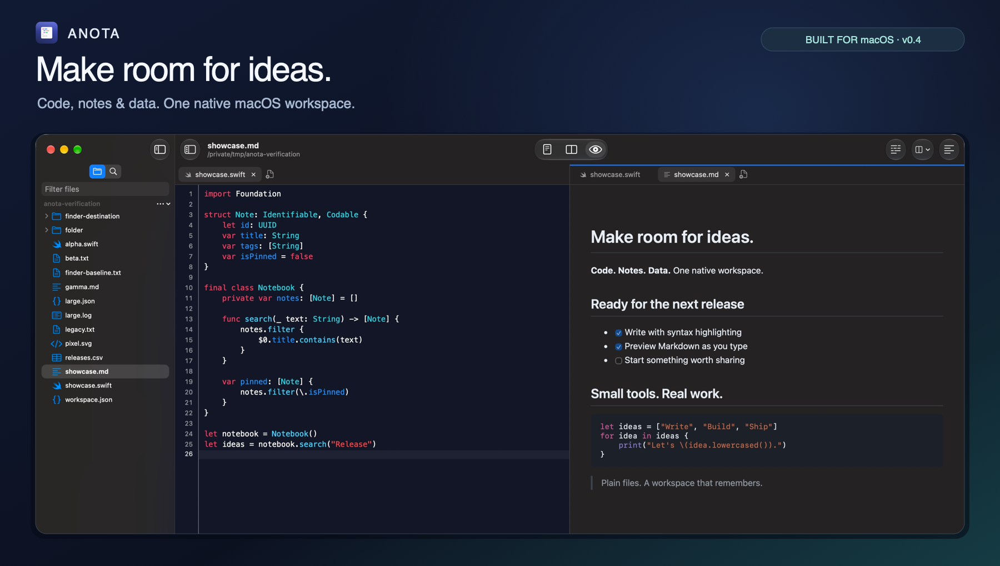

<p align="center"></p>

<h1 align="center">Anota</h1>

A simple, fast code editor for macOS.
Written in Swift (SwiftUI + AppKit).

> Status: **v0.5**. Core features work and are unit-tested. See [`.changelog`](.changelog).

[](showcase.md)

[Explore the screenshot showcase →](showcase.md)

## Features

- **Editor:** syntax highlighting (tree-sitter for 14 languages, regex for the rest; incremental, so long files stay responsive), line numbers,
  current-line highlight, auto-indent, auto-closing `() [] {} "" '' `` <>` (wraps a selection, types over
  closers, Backspace removes an empty pair, Return between `{}` opens an indented block), word wrap (toolbar, View menu, right-click or ⌥Z), and per-file undo
- **Encodings and line endings:** UTF-8 / UTF-8 BOM / UTF-16 / Latin-1 detection, LF / CRLF / CR,
  convertible from the status bar
- **Tabs:** horizontal, or vertical in a pinned "Tabs" sidebar section (⌥⌘T). Drag to reorder or to move between
  panes. Close Others / Close Tabs to the Left / to the Right / Close All. New file: the tab bar's + button or
  double-click its empty area
- **Split workspace:** split left, right, top, or bottom from the toolbar or tab menu. Drag a tab to an editor edge
  to split, or into another pane's center/tab strip to move it. Nest splits, resize either axis, and restore their
  layout and sizes on relaunch. ⌘\\ splits right; ⌥⌘\\ splits below. The same file in two panes is edited live in both
- **Directory tree:** open a folder to see a lazy-loading file tree. Drag files onto a pane/tab strip to open there,
  or onto an editor edge to split. `.git`, `node_modules` and `.build` are hidden
- **Session restore (hot exit):** unsaved and untitled files, tabs, splits and the open folder come back on relaunch.
  Recovery checkpoints run during editing and on quit. If recovery cannot be saved, quitting offers Retry,
  Save As, or Cancel Quit
- **Markdown:** Text / Split / Preview (⇧⌘V), GitHub-style rendering, light and dark
- **JSON / YAML / TOML / INI / .env / plist:** a tree view in the style of Firefox's JSON viewer, with:
  - filter, expand/collapse all
  - copy value / copy path
  - jump to source
  - inline editing of JSON values
- **Data viewer (Grid):** CSV, TSV, JSON Lines, SQLite (`.sqlite/.db`, read-only) and Excel (`.xlsx`, read-only)
  - virtualised grid: sort (click a header), filter all or one column, guessed column types, copy cell / row / column
    (⌘C copies rows as TSV), double-click a cell to see its full value, "Header row" toggle, export the shown rows as CSV or JSON
  - schema panel: SQLite tables, views, columns, keys and indexes (inferred column types for other formats)
  - **SQL box** (⌘↩ runs; SQLite dialect) with history; errors point at the line and column. SQLite files are queried
    directly; CSV/TSV/JSONL/sheets are loaded into an in-memory database, one table per file or sheet
    (`people.csv` → `people`)
  - CSV/TSV text view colours each column (rainbow CSV); JSON Lines has a Table / Raw (pretty records) toggle
- **Find & replace (⌘F / ⌥⌘F):** in the style of VS Code. Match case, whole word, regex (`$1` templates), preserve case
- **Find in files (⇧⌘F):** include/exclude globs, results grouped by file, a replace preview, and Replace All
- **Formatting:** Format Document (⌥⇧F), Format Selection (⌥⇧⌘F) and an optional Format on Save, using the
  standard tool for each language (see below). Also in the toolbar and the editor's right-click menu
- **External changes:** files changed on disk reload. If you also have unsaved edits, Anota asks which version to keep

### Syntax highlighting

| Engine | Languages |
|---|---|
| tree-sitter | JSON/JSONC, YAML, TOML, INI/.properties, Python, JavaScript/JSX, TypeScript, TSX, Go, C, C++, Rust, Swift, Bash/Zsh |
| regex | Markdown, HTML/XML, CSS, Java/Kotlin, Ruby, SQL, .env, log files (levels, timestamps, IPs, stack frames), Batch (.bat/.cmd), PowerShell (.ps1) |

### Formatters

Anota runs the formatter you already use, if it's installed. It looks on your login shell's `PATH` plus the
Homebrew, cargo, go and `~/.local` bin folders. Each tool runs in the file's folder, so project configs such as
`.prettierrc`, `rustfmt.toml` and `.clang-format` apply.

| Language | Tool (first one found) |
|---|---|
| JS / TS / TSX / CSS / HTML / Markdown / YAML / JSON | `prettier` |
| JSON (no prettier) | built-in formatter (keeps key order) |
| Go | `gofmt` |
| Rust | `rustfmt` |
| C / C++ | `clang-format` |
| Swift | `swift-format`, or `xcrun swift-format` (Xcode) |
| Python | `ruff`, then `black` |
| TOML / shell / XML | `taplo` / `shfmt` / `xmllint` |

## Install

Download `Anota-<version>-macos-arm64.dmg` from [Releases](https://github.com/emnopal/anota/releases), open it, and
drag `Anota.app` to Applications. Builds are **arm64 (Apple Silicon)** only; Intel Macs can build from source. The app is ad-hoc signed, not notarized: on first launch right-click → Open, or run
`xattr -dr com.apple.quarantine /Applications/Anota.app`.

## Requirements

- macOS 26 or later (built and tested on Apple Silicon)
- Xcode 26+ / Swift 6.2+ toolchain to build

## Build & run

```sh
swift build                    # debug build
swift test                     # unit tests
scripts/make-app.sh            # release build → build/Anota.app (ad-hoc signed)
scripts/make-app.sh debug      # debug build → build/Anota.app
open build/Anota.app
```

You can also open `Package.swift` in Xcode and run the `Anota` scheme.

To open files or a folder from the terminal:

```sh
open -a build/Anota.app path/to/folder path/to/file.json
```

## Keyboard shortcuts

| Action | Shortcut |
|---|---|
| New / Open / Close tab (or empty pane) / Close all tabs | ⌘N / ⌘O / ⌘W / ⌥⌘W |
| Save / Save As / Save All | ⌘S / ⇧⌘S / ⌥⌘S |
| Find / Find and Replace | ⌘F / ⌥⌘F |
| Find next / previous / use selection | ⌘G / ⇧⌘G / ⌘E |
| Find in Files | ⇧⌘F |
| Format Document / Format Selection | ⌥⇧F / ⌥⇧⌘F |
| Split editor right / below | ⌘\\ / ⌥⌘\\ |
| Vertical tabs | ⌥⌘T |
| Word wrap | ⌥Z |
| Cycle view mode (Text / Tree / Preview / Split) | ⇧⌘V |

VS Code shortcuts (macOS bindings):

| Action | Shortcut |
|---|---|
| Toggle line comment | ⌘/ |
| Move line up / down | ⌥↑ / ⌥↓ |
| Copy line up / down | ⇧⌥↑ / ⇧⌥↓ |
| Delete line | ⇧⌘K |
| Insert line below / above (⌘↩ runs the query in the data viewer's SQL box) | ⌘↩ / ⇧⌘↩ |
| Indent / outdent line | ⌘] / ⌘[ |
| Expand line selection | ⌘L |
| Select next occurrence (single selection) | ⌘D |
| Go to line[:column] | ⌃G |
| Next / previous tab | ⌃⇥ / ⌃⇧⇥, ⌥⌘→ / ⌥⌘← |
| Focus editor group 1–3 (one past the last splits) | ⌘1 / ⌘2 / ⌘3 |
| Reopen closed tab | ⇧⌘T |
| Toggle sidebar / show Explorer | ⌃⌘B / ⇧⌘E |
| Find in files, format, replace, word wrap, split | ⇧⌘F, ⌥⇧F, ⌥⌘F, ⌥Z, ⌘\\ (as above) |

Quick Open: ⌘P. Command palette: ⇧⌘P. New Window: ⇧⌘N. Settings: ⌘,.
Markdown: ⌘B bold, ⌘I italic; Return continues lists. Multiple selections: ⌘D adds the next occurrence, ⌥⌘↑/↓ adds a cursor above/below; Option-drag uses native column selection. Two-key chords (⌘K …) remain unimplemented.

## Project layout

```
Package.swift
Sources/
  AnotaCore/      logic with no UI (unit-tested): file decoding, highlighting, session store,
                  JSON/INI/plist/YAML/TOML parsing, search, formatter runner, line edits,
                  data readers (CSV/TSV/JSONL, SQLite wrapper, XLSX)
    Queries/      tree-sitter highlight queries (generated)
  Anota/          the app: SwiftUI + AppKit (workspace, editor view, tabs, sidebar, find, viewers, data grid)
Tests/
  AnotaCoreTests/       parser, search, layout, save and data regression tests + fixtures
  AnotaTests/           workspace, hosted-view, recovery and data acceptance tests
Vendor/
  TreeSitterGrammars/   generated tree-sitter parsers (C), vendored from release tarballs
scripts/
  make-app.sh           build the .app bundle
  make-icon.swift       render assets/AppIcon.icns
  release-tag.sh        next release tag from .version
  release-notes.sh      the .changelog section for .version
plan/                   feature status, remaining work and release history
assets/                 app icon
.github/workflows/      CI: test, build, release
  vendor-grammars.sh    re-fetch tree-sitter grammars + queries (bump versions there)
```

**Dependencies (SwiftPM):** [swift-markdown](https://github.com/swiftlang/swift-markdown),
[Yams](https://github.com/jpsim/Yams), [TOMLKit](https://github.com/LebJe/TOMLKit), and
[swift-tree-sitter](https://github.com/tree-sitter/swift-tree-sitter).

The tree-sitter grammars are vendored rather than added as packages. Two reasons:
- SwiftPM clones each package's full git history, which totals hundreds of MB for these grammars.
- Several grammar packages have manifests that leave out their external scanner, so they fail to link.

Don't edit `Vendor/` or `Sources/AnotaCore/Queries/` by hand. Change `scripts/vendor-grammars.sh` and re-run it.

## Versioning & releases

- `.version` holds the version (`0.5`). It sets the app's version; the build number is the commit count.
- `.changelog` has a `## v<version>` section per release; that section becomes the release notes.
- CI (`.github/workflows/ci.yml`) runs `swift test` and `scripts/make-app.sh` on every push and pull request.
  When both pass on `main`, it publishes a GitHub release with the zipped app:
  - `.version` changed (no `v<version>` tag yet) → release **`v<version>`**
  - `.version` unchanged → pre-release **`v<version>-rc-<UTC YYYYMMDDHHMMSS>`**, e.g. `v0.5-rc-20261106101010`
- To release a new version: bump `.version`, add its section to `.changelog`, push to `main`.

## Data & privacy

- **Session data:** stored locally in `~/Library/Application Support/Anota/Session/`. Delete that folder to start
  with a fresh session.
- **Network:** Anota makes no network requests of its own. Markdown previews block remote images and document
  JavaScript; HTTP/HTTPS links open in your browser and mailto links open in your mail app. Relative local images
  are supported; raw HTML is displayed as text.
- **Formatters:** these are your own installed tools, run only when you format (or save, with Format on Save on).

## Known limitations

- Native UI checks confirm nested splits and tab selection after pane closure. Pointer smoothness and native
  file-drop delivery still need manual verification; automated tests cover layout, drag logic and file URL transfer.

- One window per app
- Configurable initial LSP support (completion, definition, diagnostic tooltips); no git integration or terminal
- Very large files (several MB): colours of the edited line update after a short pause in typing
- YAML / TOML / INI trees are view-only. Only JSON values can be edited in the tree
- Data viewer: SQLite and Excel are read-only; grid cells can't be edited; files load fully into memory
  (queries show at most 100,000 rows, sheets 200,000); no Parquet yet
- Not notarized yet. On first launch, right-click → Open

## Third-party licenses

The vendored tree-sitter grammars are MIT-licensed; see `Vendor/TreeSitterGrammars/LICENSES/`.

### Editor/workspace settings and release packaging

Settings provides font family/size, tabs/spaces and width, wrapping defaults, System/Light/Dark/Solarized/Midnight themes, and an optional LSP executable command. Use **Restart Language Server** in ⇧⌘P after configuring the server (for example `sourcekit-lsp`, `typescript-language-server --stdio`, or `pylsp`). Servers must already be installed. Completion uses the standard Escape completion action; go to definition is in the command palette. The initial client uses UTF-16 positions and full-document updates below two million characters, without snippets, server installation, or workspace edits.

Tabs can be pinned; bulk close commands preserve pinned tabs. Close Saved preserves unsaved tabs. The file tree supports recursive live refresh, fuzzy filtering, create/inline rename, and Move to Trash. Dirty files must be saved/closed before their directory can be trashed. View mode and editor/preview scrolling are recovered per document.

Markdown export is in File; fenced code highlighting uses bundled highlight.js 11.11.1 (license included), with no network fetches. Preview document JavaScript stays disabled. PDF export is a continuous document page; HTML images retain their relative paths. Scroll sync uses proportional positions, rather than source-line anchors.

Build/package: `sh scripts/make-app.sh release`, then `sh scripts/make-dmg.sh`. The local build is ad-hoc signed. For a distributable release, set `SIGNING_IDENTITY` to a Developer ID Application identity and `NOTARY_PROFILE` to an existing notarytool Keychain profile, then run `sh scripts/notarize.sh`. This signs with hardened runtime, notarizes/staples the app and DMG, and verifies the result.
