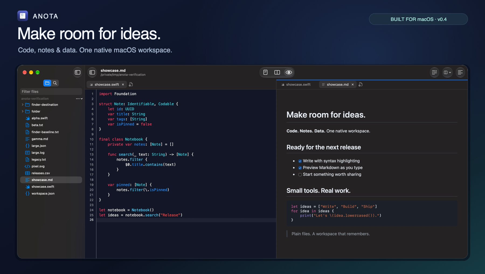
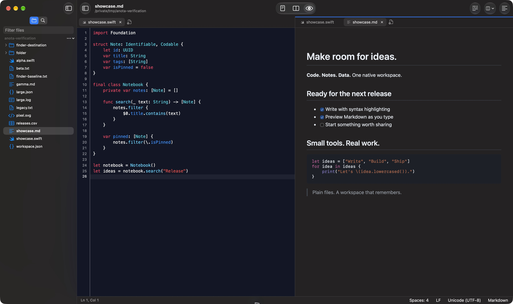
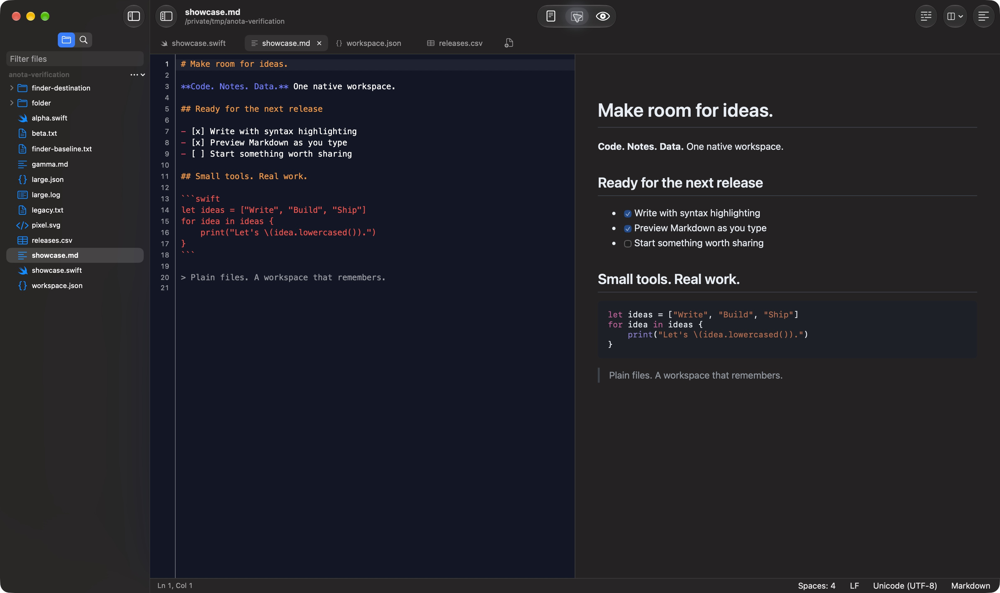
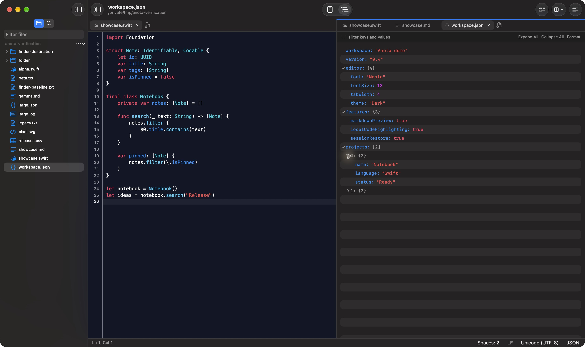
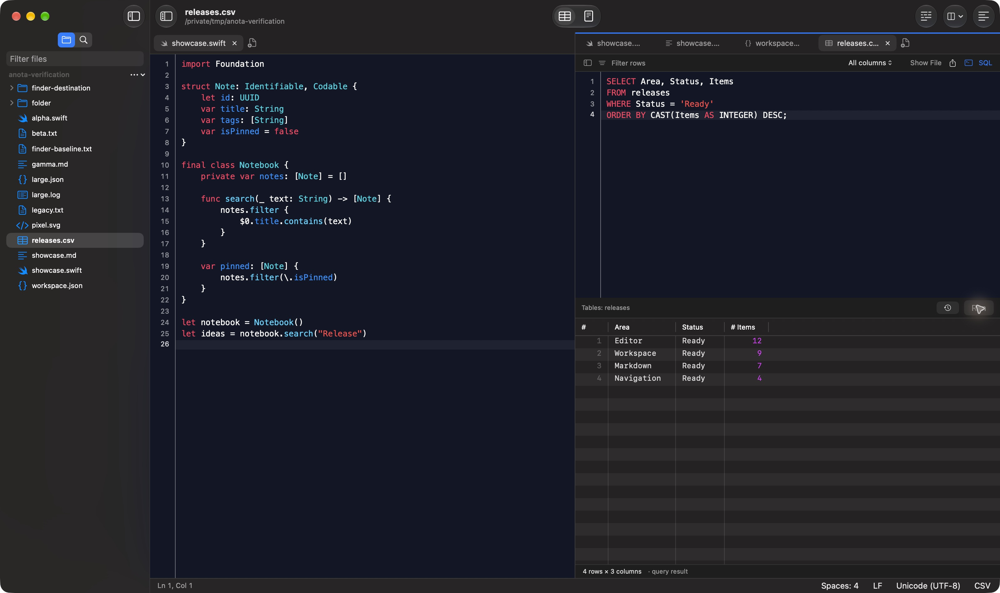
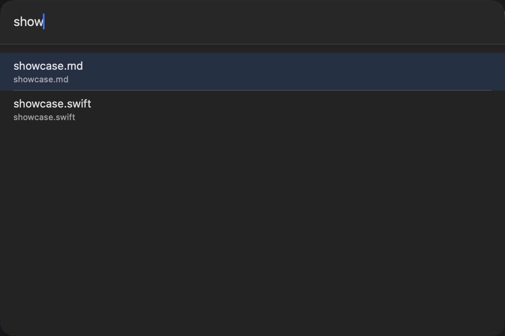
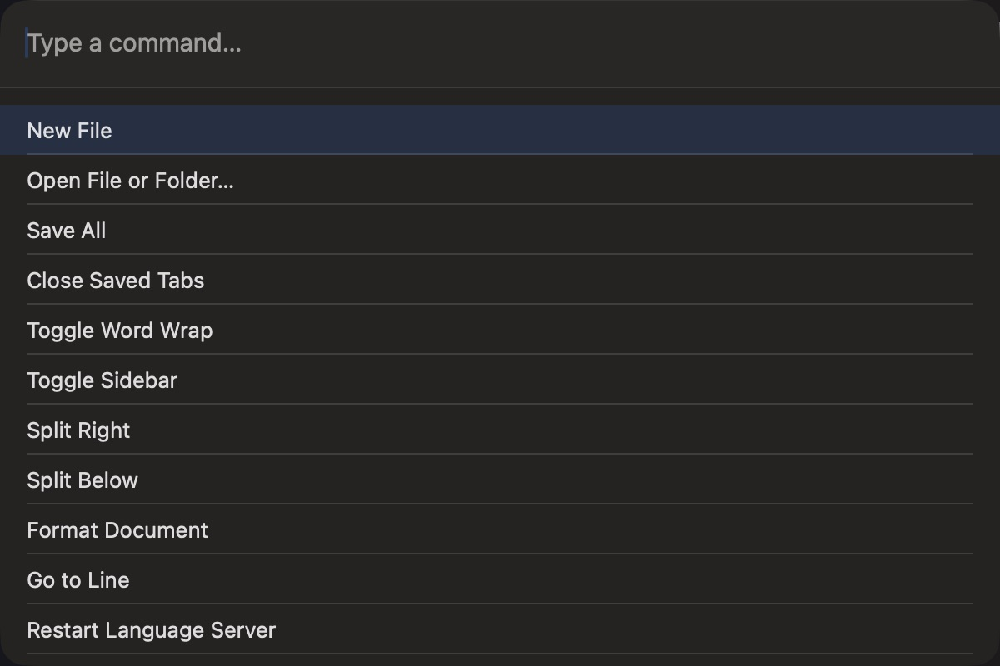
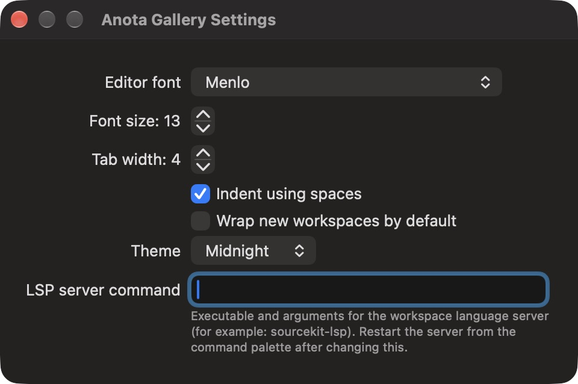

# Anota in action

Code, Markdown and structured data in one native macOS workspace.

The hero frames a cropped capture; the gallery links show the full app views.
Screenshots were captured from Anota v0.4 using
`/private/tmp/anota-verification`. The demo files are `showcase.swift`,
`showcase.md`, `workspace.json` and `releases.csv`.

## A workspace for code and notes

Keep Swift source beside a rendered Markdown document. The directory tree,
independent pane tabs, syntax colours, line numbers and document status stay
within reach. Split right with **⌘\** or use the split menu for other directions.

## Markdown, from source to preview

Switch between Text, Split and Preview with **⇧⌘V**. Split mode shows the source
beside headings, emphasis, checked and unchecked tasks, and highlighted
fenced code. Tables are supported too. Code highlighting is bundled locally. Editor and preview scrolling
sync proportionally; HTML and PDF export are available from the File menu.

## Explore structured documents

JSON opens as editable source or an expandable tree. Inspect nested objects,
arrays and typed values; filter keys and values, expand or collapse the tree,
copy paths, or jump back to the source.

## Query data without leaving the editor

Open a CSV as a grid, filter rows and inspect columns. The SQL panel can query
the file directly. Here it selects ready release items and sorts their counts
numerically while the Swift source remains open alongside it.

## Find files with Quick Open

Press **⌘P** and type part of a name. Quick Open searches the workspace with
fuzzy matching and shows relative file paths. The directory-tree filter uses
the same matcher.

## Reach commands from the keyboard

Press **⇧⌘P** to find actions such as saving, closing saved tabs, splitting
panes, formatting, navigating and exporting Markdown.

## Make the editor yours

Settings provides font family and size, tab width, spaces or tabs, the default
wrap preference and theme selection. Choose System, Light, Dark, Solarized or
Midnight. An installed language server can be configured for completion,
definition navigation and diagnostics.

## More everyday tools

| Capability | How to use it |
| --- | --- |
| Independent windows | **⇧⌘N** creates a workspace window; Finder Open With uses the last active window |
| Multiple cursors | **⌘D** selects the next occurrence; **⌥⌘↑ / ⌥⌘↓** adds a cursor above or below |
| Matching brackets | Place the caret beside a bracket to reveal its matching pair |
| Pinned tabs | Use a tab's context menu to pin it; bulk closes protect pinned tabs |
| Close Saved | File → Close Saved keeps dirty and pinned documents |
| File management | Create files/folders, rename inline and move items to Trash from the directory tree |
| Encoding control | Reopen with an explicit encoding from the document's encoding menu |
| Live refresh and recovery | Clean files refresh after disk changes; session checkpoints preserve workspace state |

[Back to the README](README.md)
